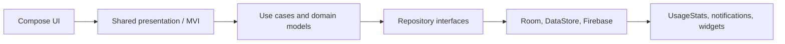

# AwareMate

[](https://github.com/husoelrey/AwareMate/actions/workflows/ci.yml)
[](https://github.com/husoelrey/AwareMate/releases/latest)
[](LICENSE)
[](https://kotlinlang.org/)
[](https://developer.android.com/)

> A compassionate, open-source Android companion for healthier digital habits and personal growth.

AwareMate helps people understand their screen time, reflect on their mood, focus with intention, and build sustainable habits. Instead of punitive streaks or hard blocking, it uses gentle nudges, gradual momentum, and a plant companion that grows with positive actions.

[Download the latest internal-test APK](https://github.com/husoelrey/AwareMate/releases/latest) · [Roadmap](ROADMAP.md) · [Privacy policy](docs/PRIVACY_POLICY.md) · [Contributing](CONTRIBUTING.md)

> [!IMPORTANT]
> The current `v1.0.0` APK is an internal-testing build signed with the documented debug-key fallback. It is not a production Play Store release.

## Highlights

- **Digital awareness:** on-device screen-time insights, mindful nudges, focus sessions, and Digital Sunset reminders.
- **Personal growth:** mood journaling, breathing exercises, offline hobby discovery, reflections, and daily micro-challenges.
- **Compassionate gamification:** a plant companion, cumulative XP, and gradual momentum instead of fragile streaks.
- **Private weekly insights:** personal mood and screen-time patterns with no rankings, comparisons, or social feed.
- **Quick check-ins:** an Android home-screen widget that uses the same mood and reward logic as the app.
- **Local-first operation:** Room is the source of truth; supported actions remain available offline and sync later.
- **User control:** in-app account and data deletion, configurable notifications, and user-initiated private image sharing.
- **Accessible UI:** Material 3, dynamic color, TalkBack semantics, and 48 dp minimum interactive targets.

## Product principles

AwareMate is designed around compassionate awareness:

- no punitive streak resets or shame-driven notifications;
- no ads, paywalls, or sale of personal data;
- no leaderboards, public profiles, or dark patterns;
- no absolute device blocking or parental surveillance;
- not a medical device or a replacement for professional care.

## Architecture

The project uses Clean Architecture with MVI-style presentation and an Android-first Kotlin Multiplatform codebase.



| Area | Technology |
| --- | --- |
| Language | Kotlin 2.2.10 |
| UI | Compose Multiplatform 1.7.3, Material 3 |
| Architecture | Kotlin Multiplatform, Clean Architecture, MVI |
| Local data | Room KMP, DataStore |
| Dependency injection | Koin |
| Navigation | Voyager |
| Cloud services | Firebase Auth, Firestore, FCM, Crashlytics, Analytics |
| Background work | WorkManager, Jetpack Glance |
| Charts | Vico |

## Repository layout

```text
androidApp/            Android application, manifest, resources, and build config
shared/src/commonMain  Shared domain, data, presentation, and Compose UI
shared/src/androidMain Android platform integrations
shared/src/iosMain     Deferred iOS implementations and stubs
shared/src/commonTest  Shared unit tests
docs/                  Privacy, store, architecture, and project documentation
.github/workflows/     Continuous integration
```

The current release target is Android. iOS, desktop, and web distribution are planned for later roadmap phases.

## Build locally

### Requirements

- JDK 17+
- Android SDK 35
- Android Studio or IntelliJ IDEA with Kotlin and Compose support
- Git

Gradle 9.5 is provided through the repository wrapper.

### Setup

```bash
git clone https://github.com/husoelrey/AwareMate.git
cd AwareMate
```

For an offline/local build, copy the placeholder Firebase configuration:

```powershell
# Windows PowerShell
Copy-Item androidApp/google-services.json.example androidApp/google-services.json
```

```bash
# macOS / Linux
cp androidApp/google-services.json.example androidApp/google-services.json
```

For live Firebase features, replace the placeholder with your own configuration for `org.awaremate.android` and enable the required Firebase services. Never commit `google-services.json`.

### Verify

```bash
./gradlew test
./gradlew lintDebug
./gradlew :androidApp:assembleDebug
```

On Windows Command Prompt, use `gradlew.bat` instead of `./gradlew`.

## Project status

- **Latest release:** [`v1.0.0`](https://github.com/husoelrey/AwareMate/releases/tag/v1.0.0)
- **Stage:** MVP ready for closed/internal Android testing
- **CI:** unit tests, lint, debug APK, and release AAB assembly
- **Next operational steps:** production signing, real Firebase configuration, Play Console setup, and final store graphics

See [CURRENT_STATUS.md](CURRENT_STATUS.md) for verified build details and [ROADMAP.md](ROADMAP.md) for planned releases.

## Contributing and security

Contributions that preserve compassionate UX, privacy, youth safety, and accessibility are welcome. Read [CONTRIBUTING.md](CONTRIBUTING.md) before opening a pull request.

Please report vulnerabilities privately as described in [SECURITY.md](SECURITY.md), not through a public issue.

## License

Licensed under the [Apache License 2.0](LICENSE).
